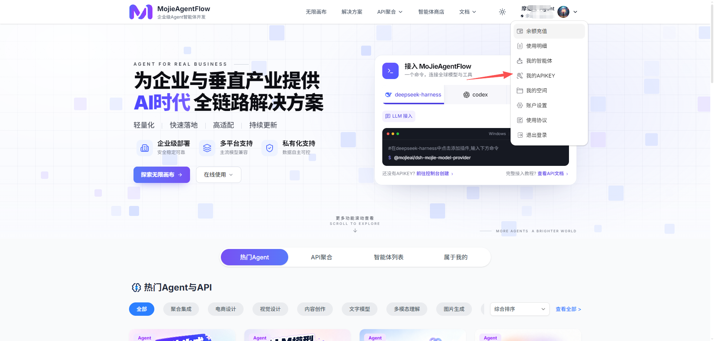
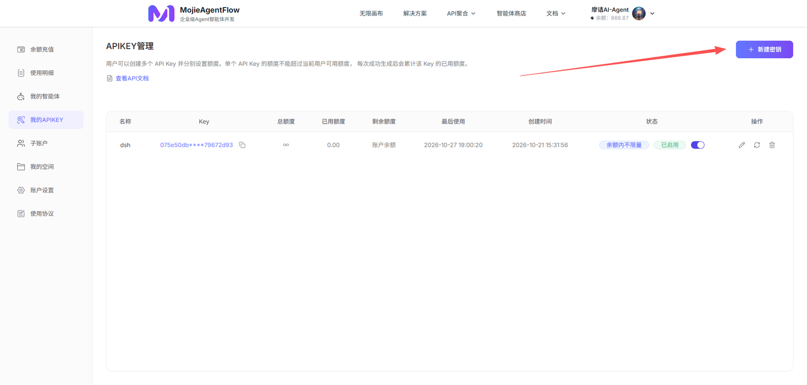
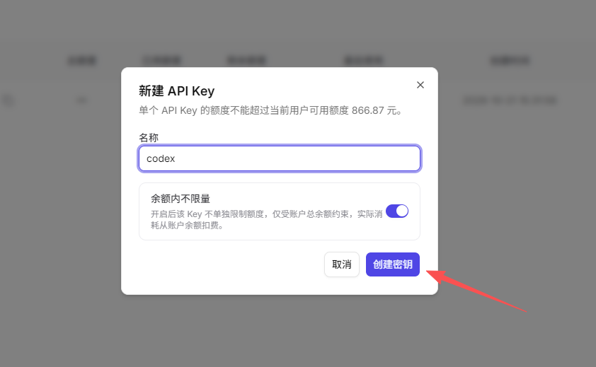
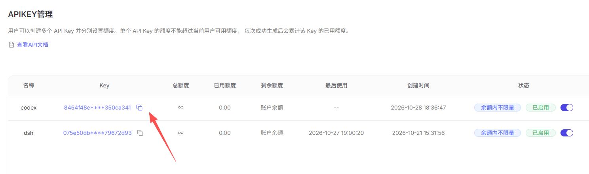
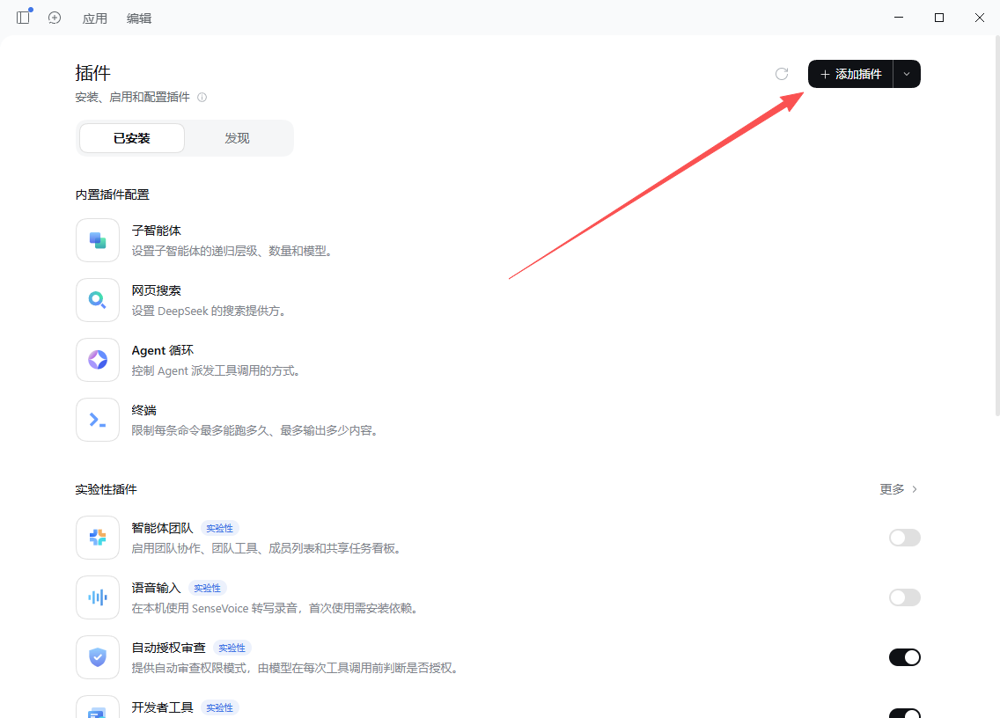

<p align="center">
  <a href="https://mojieaigc.com"></a>
</p>

<h1 align="center">Mojie dsh-mojie-model-provider</h1>
<p align="center">MojieAgentFlow全站模型deepseek-harness插件</p>

<p align="center">
  <a href="https://github.com/MoJIeAIGC">GitHub</a> ·
  <a href="https://space.bilibili.com/483532108">B站</a> ·
  <a href="https://www.douyin.com/user/MS4wLjABAAAA3JbjlCqKd8WXklSYmO64wxWeMBg4efViyTg8Gz6VZdI">抖音</a>
</p>

由 MojieAI 开发的 deepseek-harness 插件：把 Mojie（mojieaigc.com）的模型接入 DSH，填入 API Key 后 GPT / Claude / Gemini / Qwen / 豆包 / Kimi / Grok / GLM 等模型直接出现在模型下拉里，并提供原生生图（图片生成与编辑）能力。

| 用一个 Key，聊全球主流模型 | 一句话，让 AI 出图 | 像原生模型一样用 |
| :-- | :-- | :-- |
| GPT、Claude、Gemini、Qwen、DeepSeek、豆包、Kimi、Grok、GLM 等主流模型，全部出现在 DSH 的模型下拉里。 | `/image 一只戴帽子的猫` 直接把图画进对话；也可以对 AI 说「帮我画……」，它自己调用画图工具。 | 全部沿用 DSH 原生能力，习惯不用改 |


---

## 快速开始

> 🚀 三步：装插件 → 填 Key → 开始使用。

## 安装前的准备

### 1. DSH 已经装好

桌面版或命令行版都行，能打开、能收发消息就可以。

- **桌面版**：在「设置 → 通用」里能看到「当前版本：x.x.x」；
- **命令行版**：在终端里执行：

```powershell
dsh --version
```

打印出 `0.2.1-rc.2` 或更高版本就可以继续。

### 1. 创建APIKEY
1. 登录 [mojieaigc.com](https://www.mojieaigc.com)；
2. 点击右上角**个人头像**；
3. 进入 **我的APIKEY**；
4. 点击**新建密钥**，给 Key 起个名字（例如 `codex`），复制生成的那串。



进入后是 APIKEY 管理页，点右上角 **新建密钥**：





创建后回到列表，点 Key 后面的复制图标把它复制走：




> [!WARNING]
> APIKEY 是你与 MojieAgentFlow 通信的重要凭证，请妥善保管；如怀疑泄露，请及时删除并重新创建，

### 2. 安装插件

#### 方式 A · 插件市场（推荐）

1. 打开 DSH，进入 **设置**。
2. 找到 **插件 / 插件市场** 页面。
3. 搜索 **Mojie**（或包名 `@mojieai/dsh-mojie-model-provider`）。
4. 点**安装**，等它提示「已安装，请重启 DSH 加载它」，再点**完成**。





#### 方式 B · 一行命令

打开终端（PowerShell / Terminal）：

```sh
dsh plugin --profile desktop add https://github.com/MoJIeAIGC/dsh-mojie-model-provider/releases/download/v0.2.3/mojieai-dsh-mojie-model-provider-0.2.3.tgz
```

#### 装完必须重启一次

新插件是在 DSH 启动时加载的，**不重启看不到效果**。

- **Windows 桌面版**：右键托盘图标 → **退出**（只关窗口不算退出），再双击 `DeepSeek Harness` 重新打开。
- **命令行版**：结束当前的 `dsh` 进程，重新启动。

### 3. 填入API Key（一次就好）

1. 重启后进入 **设置 → 模型**。
2. 找到 **Mojie** provider 行；卡片会显示「API 密钥」。
3. 在 **API 密钥** 输入框里粘贴第 1 步复制的 Key。
4. 点卡片底部的 **保存**，看到「已保存。」即可，以后不用再填。


### 4. 正确使用

**对话界面** —— 在 **设置 → 模型** 或聊天界面的模型下拉里，选一个 Mojie 提供的模型（例如 `claude-opus-5.5`、`gpt-6-astra`、`Kimi-k3.1-pro`），然后像平时一样发消息。它和原生模型一样支持：

- **工具调用**（读写文件、跑命令、搜索等）
- **看图**（把图片拖进输入框，选一个支持图片的模型）

**图片生成** —— 可以直接在对话框中输入：

```text
/image 一只戴帽子的猫，扁平插画风，白底
```

图片生成好后，会直接出现在对话里，并附上模型名与尺寸。

---

## 直接使用图片生成

> 🎨 `/image` 可以命令直接使用图片工具而不经过大模型思考：提示词原样发给图片生成模型。

### 常用写法

| 想做什么 | 输入 |
| :-- | :-- |
| 画一张（用当前默认模型） | `/image 一只戴帽子的猫` |
| 编辑 / 融合（附带图片） | 把图片拖进输入框，输入 `/image 把这两张图融合成一张` |
| 本次换模型 | `/image 一只猫 --model mojie-nanobanana-2` |
| 指定分辨率与比例 | `/image 赛博朋克风的城市夜景 --resolution 2K --ratio 16:9` |
| 高级参数（模型特定） | `/image 产品主图 --quality max --background transparent` |
| 列出可用的画图模型 | `/image models`（每个模型会标注支持哪些高级参数） |
| 切换默认模型 | `/image model mojie-nanobanana-2` |
| 恢复内置默认 | `/image model auto` |
| 续查没跑完的任务 | `/image task <任务ID>` |
| 查看用法 | `/image help` |


参数可以简写：`--model`/`-m`、`--resolution`/`-r`、`--ratio`/`--aspect-ratio`/`-a`，也支持 `--model=mojie-nanobanana-2` 这种等号写法。

### 高级穿透参数（模型特定）

厂商文档的「高级穿透参数」已经打通，命令行与工具都支持；这些参数**只对文档列出的模型有效**，传给别的模型会直接报错（在本地拦下，不会白建一个注定失败的任务）：

| 参数 | 适用模型 | 可选值 | `/image` 开关 |
| :-- | :-- | :-- | :-- |
| `thinking_level` | `Mojie-Nanobanana-2` / `Mojie-Nanobanana-pro` | `minimal` / `low` / `medium` / `high` | `--thinking-level` |
| `quality` | `Mojie-image-2`（4 档）/ `mojie-image-2-5-sunburst` / `mojie-image-2-5-flare`（多一档 `max`） | `auto` / `low` / `medium` / `high` / `max` | `--quality` |
| `background` | `mojie-image-2-5-sunburst` / `mojie-image-2-5-flare` | `auto` / `transparent` / `opaque` | `--background` |
| `width` / `height` | `flux-2-pro` / `seedream-5-image` / `Qwen-image-3.0` | 16–8192 的整数像素 | `--width` / `--height` |
| `sequential_image_generation` | `seedream-5-image` | `disabled` / `auto` | `--sequential` |

> [!IMPORTANT]
> 模型清单与取值以厂商文档为准：<https://www.mojieaigc.com/docs/84c92eb8-f0c1-4e66-935f-96d3a73715c6>（文档里的 `flux-2-pro` / `Qwen-image-3.0` 在实际接口里是 `flux2-pro` / `qwen-image-3`，插件两种写法都认）。
>
> 不确定某个模型支持哪些高级参数时，先运行 `/image models` 或让 AI 调用 `mojie_list_image_models`——输出会逐个模型标注它支持的高级参数与取值。

### 设置默认画图模型

1. **设置 → 模型 → Mojie** 行，展开 **自定义设置**。
2. 找到 **图片生成默认模型** 输入框（可下拉选择，也可手动输入模型 id）；列表为空就点右侧 **刷新图片模型**。
3. 选一个（例如 `seedream-5-image`、`mojie-nanobanana-2`），点卡片底部的 **保存**。

之后 `/image …` 和 AI 自己画图都会用这个模型。也可以随时用 `/image model <模型名>` 切换——两处改的是同一个设置。

> [!IMPORTANT]
> 对话里 AI 调用画图工具时，**只有你明确点名某个模型**它才会传 `model` 参数；没点名就省略，使用这里设置的默认模型。
>
>
> 模型名可以模糊说（例如“用 image 2.5”）：AI 会先用 `mojie_list_image_models` 把模糊名解析成唯一的确切 id；如果有多个模型都匹配，它会先问你要哪一个。


### 图片生成工具调用

插件注册了 4 个原生工具，AI 会在需要时自己调用：

| 工具 | 用途 |
| :-- | :-- |
| `mojie_generate_image` | 文字生图，可指定模型、分辨率、比例，以及模型特定的高级穿透参数 |
| `mojie_edit_image` | 改图 / 重绘 / 多图融合；所有参考图都放 `input_images` 数组（一张也传数组），按顺序提交；同样接受高级穿透参数 |
| `mojie_list_image_models` | 列出当前 Key 可用的画图模型，并标注每个模型支持哪些高级参数 |
| `mojie_image_task` | 查询任务状态，完成后把图取回对话 |

- **画**：直接说「帮我画一张……」即可，AI 会把图画进对话。
- **改**：把图片拖进输入框，说「把这张图的背景换成沙滩」「改成蓝色电影色调」，AI 会把结果图发回来。
- **多图融合**：一句话里给多张参考图（对话里贴多张，或让 AI 用 `input_images` 传多个路径），按你给的顺序提交。
- **图在哪**：生成/编辑的原图按厂商字节直接写进**当前会话的工作目录**（`mojie-<任务ID>-<序号>.<扩展名>`，也会保存url在历史记录中，不覆盖、不压缩、Provider 返回几张就存几张）；对话里显示的压缩副本（由 DSH 附件存储按默认规则规范化，仅用于看），原图路径在「查看详情」里。


---

## 模型清单

<details>
<summary><b>OpenAI · GPT</b>（11）</summary>

`gpt-6.1-sol`、`gpt-6-sol`、`gpt-6-luna`、`gpt-6-astra`、`gpt-5.6-terra-pro`、`gpt-5.6-terra`、`gpt-5.6-sol`、`gpt-5.6-luna-pro`、`gpt-5.6-luna`、`gpt-5.5`、`gpt-5.4`

</details>

<details>
<summary><b>Anthropic · Claude</b>（14）</summary>

`claude-opus-5.5`、`claude-sonnet-5.5`、`claude-haiku-5.5`、`claude-opus-5`、`claude-sonnet-5`、`claude-fable-5.1`、`claude-fable-5`、`claude-opus-4.8`、`claude-opus-4.7`、`claude-sonnet-4.6`、`claude-opus-4.6`、`claude-sonnet-4.5`、`claude-opus-4.5`、`claude-haiku-4.5`

</details>

<details>
<summary><b>Google · Gemini</b>（9）</summary>

`gemini-4-argon`、`gemini-3.8-flash`、`gemini-3.7-flash`、`gemini-3.6-flash`、`gemini-3.5-flash`、`gemini-3.5-flash-lite`、`gemini-3.1-pro-preview`、`gemini-3.1-flash-lite`、`gemini-3-flash-preview`

</details>

<details>
<summary><b>阿里 · Qwen</b>（8）</summary>

`qwen3.8-max`、`qwen3.8-omni-flash`、`qwen3.8-flash`、`qwen3.7-max`、`qwen3.7-plus`、`qwen3.7-flash`、`qwen3.6-plus`、`qwen3.6-flash`

</details>

<details>
<summary><b>字节 · 豆包</b>（7）</summary>

`doubao-seed-2-1-pro`、`doubao-seed-2-1-turbo`、`doubao-seed-2-1-lite`、`doubao-seed-2-0-lite`、`doubao-seed-2-0-mini`、`doubao-seed-2-0-code-preview`、`doubao-seed-character`

</details>

<details>
<summary><b>智谱 · GLM</b>（6）</summary>

`GLM-5.3`、`GLM-5.3-FlashX`、`GLM-5.3-Flash`、`GLM-5.2`、`GLM-5.1`、`GLM-5`

</details>

<details>
<summary><b>Moonshot · Kimi</b>（4）</summary>

`kimi-k3.1-pro`、`kimi-k3.1-pro-highspeed`、`kimi-k3`、`kimi-k2.7-code`

</details>

<details>
<summary><b>xAI · Grok</b>（4）</summary>

`grok-4.7`、`grok-4.6`、`grok-4.5`、`grok-4.3`

</details>

<details>
<summary><b>DeepSeek</b>（2）</summary>

`deepseek-v4-pro`、`deepseek-v4-flash`

</details>

> [!NOTE]
> 清单会随主站更新。每个模型的 **上下文窗口、最大输出 token 数、输入类型、推理等级** 会一并自动填写。点 **获取可用模型** 可以搜索、勾选并 **更新列表**；
---


## 常见问题

<details>
<summary><b>设置里模型目录是空的？</b></summary>

模型目录默认由内置快照自动填写，即使还没联网也能看到全部模型。要拿到主站最新清单，先确认 API Key 已保存（卡片上会显示「已配置凭据」），再展开 **自定义设置** 点 **获取可用模型**，勾选后点 **更新列表**；画图模型则点 **刷新图片模型**。如果仍然为空，检查主站余额是否用完，或 API 地址是否被改错。

</details>

<details>
<summary><b>画图报 AUTH / 401？</b></summary>

Key 复制错了或已失效。回主站「个人中心 → API-KEY」重新复制一次，粘进卡片保存即可。注意别把首尾空格一起粘进去。

</details>

<details>
<summary><b>提示 RATE_LIMIT / 上游繁忙？</b></summary>

主站临时限流，等几十秒再试。画图失败通常不会产生可用的创作结果，可以直接重发。

</details>

<details>
<summary><b>/image 命令打不出来？</b></summary>

按顺序自查：

1. 插件已安装，并且**重启过** DSH；
2. 设置 → 模型里能看到 **Mojie** 这一行（行内是 API 密钥 + 自定义设置）；
3. 在输入框敲 `/`，菜单里能看到 **image**。

</details>

<details>
<summary><b>怎么升级插件？</b></summary>

在插件市场点更新；或先卸载再装新版 tarball，然后重启。。

</details>

<details>
<summary><b>怎么卸载？</b></summary>

在插件市场点卸载，或执行：

```sh
dsh plugin --profile desktop remove "@mojieai/dsh-mojie-model-provider"
```

然后重启 DSH。已生成的原图仍在各会话的工作目录里，不会被删掉。

</details>

<details>
<summary><b>费用怎么算？</b></summary>

由 Mojie 主站按点数计费（聊天按 token、画图按张 / 分辨率），DSH 这边不额外收费。具体价格见主站。
余额不足请前往[Mojieaigc.com](https://www.mojieaigc.com) 充值

</details>

---

## 隐私与安全

- **Key 只在本机**：保存在 DSH 的凭据存储里（或 `MOJIE_API_KEY` 环境变量），不写进插件配置，也不进入对话内容。
- **请求直连主站**：聊天与画图请求直接发往 `mojieaigc.com`，不经过第三方中转。
- **图片留在本地**：生成的原图（与厂商字节一致）写进当前会话的工作目录，方便之后继续查看或二次编辑；对话显示副本存放在本机附件目录。
- **别把 Key 贴出去**：不要贴进对话、截图或代码仓库；怀疑泄露时，去主站重置 Key 再改一遍设置。

---

遇到问题或想提需求，欢迎到 [MojieAgentflow](https://www.mojieaigc.com) 查看联系方式。

